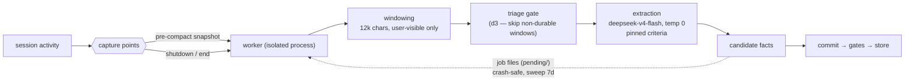

# Phase 1 · Capture: sessions → candidate facts

**Status:** shipped · **Concepts you need:**
[capture, extraction](reading-guide.md#glossary),
[gate / judge](reading-guide.md#glossary) · **Last verified:** 2026-11

---

## Goal

Turn every session into a set of candidate [facts](reading-guide.md#glossary)
— atomically, without ever losing content the harness itself is about to
throw away.

## How it works

Two capture points exist because **each is a leak**: before compaction the
harness permanently deletes transcript content, and at shutdown the session
simply ends. Capture runs in a **separate worker process** with a lock file
per scope, so a TUI crash cannot take the in-flight capture with it, and
concurrent captures coalesce into one drain.

The pipeline inside the worker:

1. **Snapshot** — the pre-compact hook passes the exact messages plus a
   pinned base digest (so the model sees continuity, not a cold start).
2. **Windowing** — snapshots are chunked at 12k characters; only text the
   user actually saw is kept (tool noise excluded).
3. **Triage** — the d3 gate judges each window "associated with durable
   fact content? y/n"; on real coding windows ~13% survive
   (decision-model spike, E1).
4. **Extraction** — for surviving windows, the LLM extracts atomic facts
   under pinned, plural criteria ("Facts", not "Fact" — count must not be
   constrained). A repair pass re-parses malformed structured output before
   anything is dropped (ADR 003).
5. **Commit** — candidates flow to the gate chain
   ([`03-gates.md`](03-gates.md)) and the store.

Jobs are plain files under `~/.config/kimchi/memory/pending/`, lock-coalesced
per (scope, file ref), swept after 7 days. Users can opt out per session
(`memory-toggle-extension.ts`, `session_automemory` flag — the flag only
gates *new* work; a drain in flight finishes).

## Guarantees

- **No silent loss at the two leak points.** Pre-compact + shutdown are the
  only moments content vanishes unrecoverably; both are instrumented.
- **Crash honesty.** Worker isolation + on-disk jobs mean a harness crash
  pauses capture, it does not destroy it (up to the 7-day sweep).
- **Digest continuity.** The pinned base digest is included so dense-context
  runs capture the same way as fresh ones — pre-compact snapshots routinely
  carry very large offsets.

## Failure modes on record

- **Extractor over-emission** — on real coding windows, ~66% of what raw
  extraction emits is transient junk by the intended taxonomy (spike E2).
  This is why capture is paired with gates; the fix is downstream, not here.
- **Criteria-shape blindness** — criterion wording that paraphrases the
  taxonomy instead of deriving from it blinds extraction/triage to whole
  fact classes (spike E5: the assistant-engaged class went 0/4 until criteria
  were verbatim). Guarded by pinned criteria (ADR 003).
- **Voice drift** — real-store dumps show extraction occasionally emits
  assistant-voice work-log lines ("I learned…", "I determined…"); the
  durability gate and local cleanup passes exist because of this
  (`.kimchi/docs/memory-cleanup.ts`).
- **Silent starvation** — during the October gateway outage every
  embed/add failed upstream and **22 capture jobs quietly backlogged** for
  days; the 7-day sweep would have begun destroying them. Caught manually.
  The correction (backlog-age alerting) lives with operations:
  [`07-measurement.md`](07-measurement.md).

## Code pointers

`capture.ts` (points, windowing, extraction, repair) ·
`capture-worker.ts` (isolated process, job atomics, sweep) ·
`admin.ts` (enable/disable per scope) · `lock.ts` (coalescing locks) ·
`gates.ts` (triage criteria ADR 003 inherits from here).

## Open items

- Backlog-age alerting (incident-driven; see failure mode above).
- Backlog processing UX (manual drain today).
