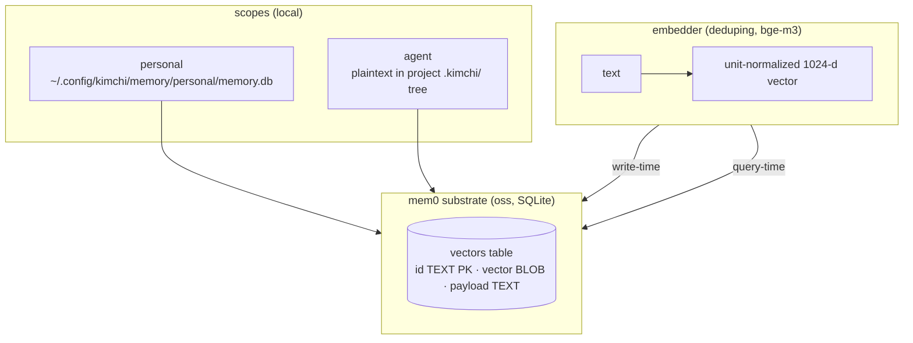

# Phase 2 · Storage & embeddings

**Status:** shipped · **Concepts you need:**
[embedding, embedding space, cosine similarity](reading-guide.md#glossary) ·
**Last verified:** 2026-11

---

## Goal

Keep facts durable, searchable by meaning, and separated by scope — with a
schema simple enough to inspect by hand.

## How it works

- **Substrate: mem0ai/oss.** The store is mem0's SQLite vector layout
  exercised through the backend; Kimchi wraps, not replaces, its key
  machinery (ADR 001).
- **Observed schema (live store):** one table —
  `vectors(id TEXT PRIMARY KEY, vector BLOB, payload TEXT)`. Vectors are
  **float32, 1024-dim, unit-normalized** (an earlier decode attempt assumed
  float64 and produced nonsense norms — the decoded lengths were the tell).
  Payloads are **plaintext JSON**
  `{"user_id": <scope>, "data": <fact>, "hash": <hash>, "textLemmatized": <normalized>}`
  — plaintext because an earlier iteration encrypted field slices, and
  per-field envelope crypto made search impossible (search is vector-only,
  over `textLemmatized`).
- **Scopes** (`scope.ts`): today `personal` (user-private, lives outside the
  project tree) and `agent` (project-shared, plaintext by design). Project
  memory DBs live under `~/.config/kimchi/memory/projects/<owner>/<name>/`.
- **Deduping embedder** (`embedder.ts`): bge-m3 vectors with a built-in
  normalize step; identical texts are not re-embedded.
- **Migration history (one paragraph):** payloads went from per-field
  encrypted envelopes to plaintext JSON in the 2026-10 restructure. One
  incident is on record: a stale-row-dropping hash skimmed a single fact
  the night before a study snapshot, so that study's real store reads as
  184 of 185 dims (whitepaper §5.10 records the caveat).

## Guarantees

- **Unit sphere.** Every stored vector is normalized; the geometric claims
  in [`06-dreaming.md`](06-dreaming.md) and
  [`appendix-formal.md`](appendix-formal.md) assume cosine-on-sphere
  semantics and are measured against this store's empirical background
  distribution.
- **Inspectability.** One table, plaintext payloads: `sqlite3
  memory.db 'select payload from vectors limit 1'` audits the whole
  subsystem by hand.
- **Auditable hygiene.** Local cleanup passes delete through the same
  backend path as `/memory delete`, leaving the same history trail.

## Failure modes on record

- **Threshold death across encoders** — the production 0.2 relevance floor
  was calibrated for a different embedding model; with bge-m3, top-8 scores
  bottom out around 0.39, so the floor passed everything (8/8) and filtered
  nothing (spike E8). Lesson, now a standing rule (ADR 005): **every
  threshold is re-derived from the current encoder's measured moments.**
- **Hash drift** — normalization/hash mismatch can desync dedupe identity
  from payload identity (the skimmed-fact incident above).
- **Per-field crypto is a dead end for search** — the reason the payload is
  plaintext today. Any future protection must cover the whole row/store, not
  searchable fields.

## Code pointers

`backend.ts` (mem0 wrapper, store paths) · `embedder.ts` (deduping,
normalize) · `scope.ts` (personal/agent + project DB routing) ·
`backend.check.ts` (subsystem probe; **PART A** runs locally without
credentials — the PART B live-API section is not part of any docs or book
gate).

## Open items

- Deferred-protection exploration for the personal scope (whole-store
  layer, not per-field).
- Encoder-change re-calibration protocol (moments + bands re-measured) —
  formalized in [`maintenance.md`](maintenance.md).
