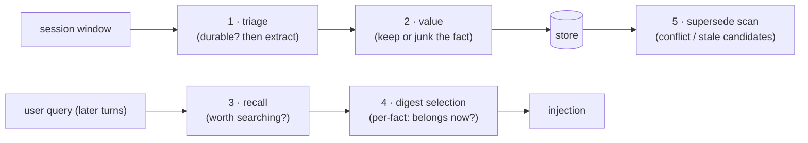

# Phase 3 · Quality gates & d3

**Status:** shipped · **Concepts you need:**
[gate, judge, digest](reading-guide.md#glossary) · **Last verified:** 2026-11

---

## Goal

Keep transient noise out of the store and out of the digest — cheaply,
calibrated, and without pretending that "passed a gate" means "true".

## The five gates

1. **Triage** (capture path): is this window durable-fact-bearing at all?
   ~87% of real coding windows are skipped here, cutting extraction calls by
   ~93% (spike E1).
2. **Value** (capture path): per extracted fact — keep or discard? Keeps only
   ~34% of what extraction emits on coding windows (spike E2).
3. **Recall gate** (retrieval path, turns ≥2): is this user turn worth a
   memory search? Kills content-free-turn retrievals ("continue", "still
   failing") — searches dropped 9→1 over 20 simulated turns at ~316 ms p50
   (spike E4).
4. **Digest selection** (retrieval path): per candidate fact — does it belong
   in *this* digest? Handles the null case (inject nothing rather than 5
   misleading facts; spike E3/E8).
5. **Supersede scan** (store hygiene): pairs candidates for conflict/stale
   judgment — details in [`04-supersede.md`](04-supersede.md).

## The d3 contract

The judge is the `systemone` decision model:

- `POST /typesafe/v1/systemone`, `{model, state, questions{…}}` — results
  keyed by question name; **typed choices with probabilities** (not free
  text), so verdicts are threshold-tunable.
- **Input-token-only cost** (output tokens = 0); warm latency ~300–450 ms
  for a 1-question call, ~0.7–1.2 s for an 8-question batch (spike API
  characterization).
- **64 questions per call, hard cap** (platform limit found in spike E6);
  valuation batches are capped below that.
- Decisions are batched through a decision gate (`decision-gate.ts`) with
  an always-open mode for off/disabled states.

## Criteria discipline (the load-bearing rule)

Criterion strings are **pinned constants derived verbatim from the
extraction criteria**, never paraphrased (ADR 003). Why: in spike E5, a
paraphrased criterion ("assistant content is non-durable") silently deleted
an entire fact class from capture — 0/4 needle windows — until the criteria
were re-derived; after the fix, 4/4. Changing criteria requires the
regression protocol in [`07-measurement.md`](07-measurement.md).

## Measured calibration (dreaming-era battery)

The same judge verifies synthesized memories; its error behavior was measured
directly: **68-item battery, 0 of 24 adversarial unsupported candidates
promoted to the safety-critical top tier** (one-sided 95% CI [0, 12%] at the
battery size), 18/18 supported items certified (whitepaper §5.11). The
adversarial set covers the realistic derailments: numeric/value tweaks, unit
confusion, date bugs, possession-hijack, hedge-drop.

## Failure modes on record

- **Whole-class blindness from criterion drift** (E5) — the incident that
  produced ADR 003.
- **Author-judges-own-work would inherit synthesis drift** — why the judge
  is a separate model from the extractor/synthesizer (ADR 007).
- **Gate ≠ truth** — gates stop noise; they do not certify facts. Tiers do
  that ([`06-dreaming.md`](06-dreaming.md)).

## Code pointers

`gates.ts` (pinned criterion strings, gate criteria) · `decision-gate.ts`
(batched question plumbing, always-open mode) · `decision-model-spike/report.md`
(E1–E8 evidence) · dreaming-era battery in whitepaper §5.11.

## Open items

- Judge-swap study (swap d3 for a different evaluator; verify the battery
  travels — [whitepaper §9](06-dreaming.md)).
