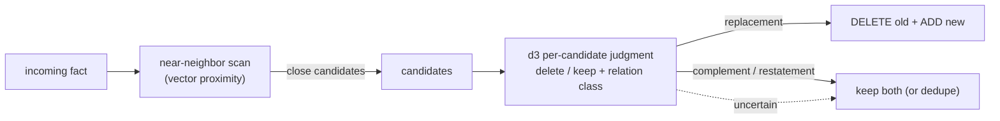

# Phase 4 · Supersede & staleness

**Status:** shipped · **Concepts you need:**
[supersede, forgetting, updating](reading-guide.md#glossary) ·
**Last verified:** 2026-11

---

## Goal

Retire facts the world has moved past — without ever destroying a memory that
was still good.

## How it works

The replacement judgment is **not vector equality and not a generic LLM
prompt.** Each candidate pair is judged by d3 with a conservative-deletion
constitution: *only delete when certain the new information replaces the
old; prefer keeping both when the replacement may be wrong* (ADR 004).
Relation classes (`replacement`, `update_complement`, `duplicate`) are
returned alongside the verdict — richer than the bare delete-id list the
prompt-era judge produced.

## Guarantees (measured)

1. **The canonical failure is caught.** Production's prompt-era judge once
   *deleted nothing* on an explicit preference reversal ("stop creating
   branches" vs stored "prefer new branch"). The d3 judge deletes such
   reversals at pDel = 1.0 (spike E7 Part A).
2. **Judged DELETEs are verify-clean.** In the adversarial near-miss
   battery, every case where deletion would destroy a true memory was kept;
   judged deletions worth keeping: **0** (whitepaper §5.11 — includes the
   TWIN and STALE fixtures).
3. **Conservative on ambiguity.** Value tweaks, unit confusion, and
   possession slides that *look* like updates are kept-pending rather than
   erased (same battery; pairs with the dreaming tiers).

## Failure modes on record

- **Add-only rot** (the reason this phase exists): outdated facts accumulate
  and answer queries as if current.
- **Prompt-judge false-negative**: the missed explicit reversal above.
- **Relation loss on deletes**: the old contract returned bare delete-ids,
  erasing *why* a memory died; the current judgment keeps the relation class.
- **Dreaming-era risk, contained**: freely-rewriting stores are vulnerable
  to LLM drift; mitigated here by tiers (`06-dreaming.md`) and by the
  conservative rule.

## Honest comparison

Graphiti/Zep keeps **bi-temporal invalidation edges** — a structural
"this relationship was valid until t" marker. We keep a judged overwrite
with conservative rules. Their model preserves history structurally; ours
preserves truth-in-present with verified deletion. Different tradeoff; the
whitepaper §6.2 comparison notes this as genuine prior art, not a gap we
claim to surpass.

## Code pointers

`supersede.ts` (+ its tests) — the judged DELETE+ADD path.

## Open items

- Periodic store-consolidation sweep (the scan E7 Part B prototyped:
  13/13 twin groups, 0 false positives) — subsumed into dreaming's
  discover-before-synthesize design ([`06-dreaming.md`](06-dreaming.md)).
