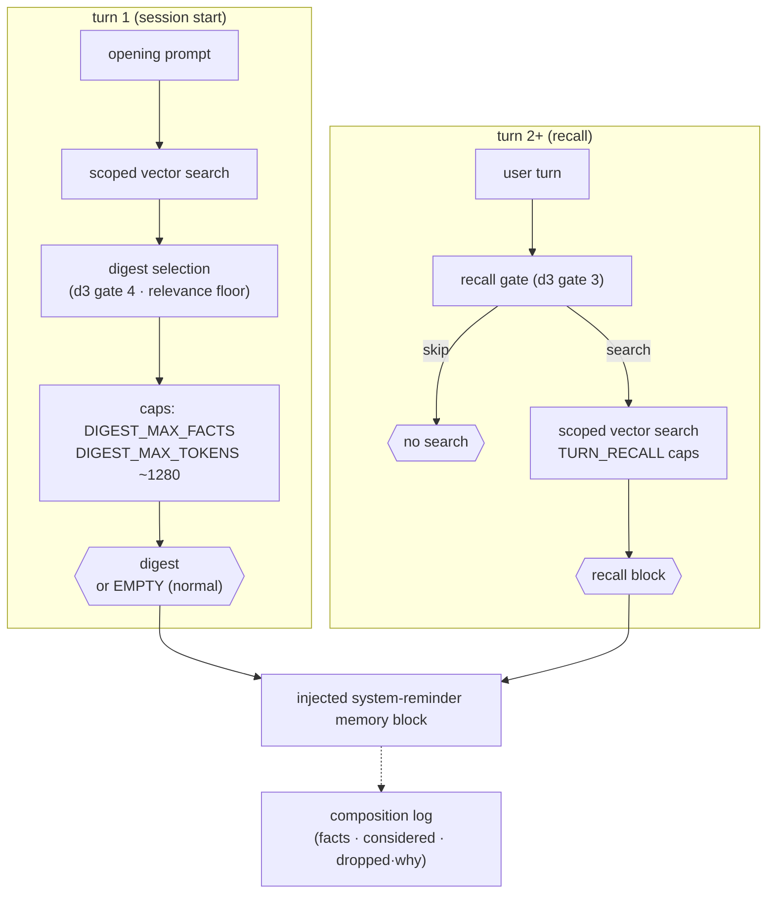

# Phase 5 · Retrieval, injection & display budget

**Status:** shipped · **Concepts you need:**
[digest, retrieval, condensation](reading-guide.md#glossary) ·
**Last verified:** 2026-11

> **Naming note.** `docs/memory-residency.md` — despite its title — is about
> *session heap residency* (externalizing large session content to disk), a
> different subsystem. This page covers **memory-feature injection budgets**;
> the session-residency document is not a source here.

---

## Goal

Put the right memories in front of the model at the right moment — and nothing
else. Injection is a **value gate**: memory must earn its tokens, and an
empty digest is a normal outcome, not an error (`inject.ts` module contract).

## How it works

- **Query-grounded, thresholded, capped.** Retrieval runs against the scoped
  store; candidates clear a relevance floor, then the d3 selector picks what
  belongs *now* (gate 4), then fact-count and token budgets cap the digest.
- **Recall gating on later turns.** Most turns do not warrant a search at
  all; the recall gate dropped searches 9→1 over a 20-turn simulated session
  at ~316 ms p50 (spike E4).
- **Null-safe.** The selector demonstrably injects **0 facts** when the
  store has nothing relevant, where a rank baseline would inject 5
  misleading keyword collisions (spike E8).
- **Every injection is measured.** The composition log records facts,
  candidates considered, and per-reason drops — this is the input to the
  digest-value measurement in [`07-measurement.md`](07-measurement.md).
- **Etiquette.** Memory is injected as a bounded system-reminder block, so
  the model treats it as trusted-but-not-authoritative context.

## Display surface

`/memory` opens the memory panel: digest composition, pending capture jobs,
search and management (`memory-panel.ts`). `/memory:digest` reproduces the
startup digest exactly as the model saw it (observability contract —
calibration fails on reproducibility too).

## Failure modes on record

- **Threshold death** (spike E8/2.2): floors are encoder-distribution
  constants — re-derive on encoder change (ADR 005).
- **Keyword-collision junk and same-session echoes** when relying on raw
  rank (E3) — the selector exists because of these.
- **Recall spam** on content-free turns (E4) — the recall gate exists
  because of these.
- **Vector-only guarantee**: payload plaintext + vector search over the
  lemmatized text means retrieval can never match on un-embedded phrasing;
  restating the same fact with different words is a *dedupe* concern, fixed
  upstream at write time, not here.

## Code pointers

`inject.ts` (digest builder + composition log) · `config.ts`
(DIGEST_MAX_FACTS / DIGEST_MAX_TOKENS / floors / TURN_RECALL caps) ·
`scoped-searcher.ts` (scope-aware search) · `memory-panel.ts` (display) ·
gates 3–4 in [`03-gates.md`](03-gates.md).

## Open items

- Digest-value metric automation into the periodic ops run
  ([`07-measurement.md`](07-measurement.md)).
- Encoder-change re-calibration (shared with 2.2).
