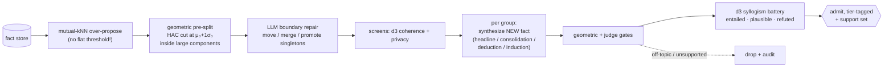

# Phase 6 · Dreaming: synthesizing verified new memories

> **Status: RESEARCHED — measured and specified end-to-end, not implemented.**
> No `memory dream` command exists today; everything on this page ran as
> read-only scripts against real stores. The implementation is a roadmap
> item. Full record: `docs/research/memory-dreaming-whitepaper.md`; proofs:
> [`appendix-formal.md`](appendix-formal.md).

**Status:** RESEARCHED · **Concepts you need:** [background distribution, landing band, paraphrase
ceiling, synthesis kinds, support set, truth tiers](reading-guide.md#glossary)
· **Last verified:** 2026-11

---

## Goal

Go beyond what was ever explicitly written: find groups of stored facts that
jointly *imply* something new, synthesize that implication, verify it
independently, and admit it labeled by how strongly it is supported.

## How it works (the v2 pipeline)

Three lessons are in the shape of this diagram:

1. **Discovery divides the labor.** Flat thresholds failed twice (0/3 seed
   recall; 0/4 at scale); LLM-alone partition degraded past ~15 facts.
   Geometry over-proposes and pre-splits; the LLM repairs boundaries. Neither
   alone was recoverable; the division was (v1 → v2, all four targets at
   0.765–0.845 similarity).
2. **There is a headline kind.** The most valuable syntheses *name* the
   umbrella claim a group embodies ("kimchi is a VS Code extension …") —
   all seeded-target and real-store recoveries arrived through this channel.
3. **Verification is independent.** The synthesizer never grades its own
   work: geometry classifies landing position against the measured
   background, and d3 judges entailment per cluster with the candidate
   embedded *per question* (state-syllogism battery).

## The guarantees (proof sketches — full proofs in the appendix)

- **The sphere is measurable.** Unrelated facts concentrate with
  characteristic spread in high dimension, so μ₀/σ₀ are computable from the
  store itself — no hand-tuned bar anywhere (Lemma 1 → ADR 005).
- **The landing band classifies.** Above the paraphrase ceiling: an
  accidental duplicate. Inside (μ₀+2σ₀, qP): resembles what is known ⇒
  consolidation. Near-support penumbra: candidate deduction/induction ⇒
  judge. Beyond: hallucination ⇒ drop (Theorem 2, measured: a candidate at
  μ₀+2σ₀ with a far-out support is a geometric candidate for
  deduction/induction — the judge decides).
- **Small stores get advisory-only bands.** Below store size 10 the band
  misclassifies (measured) — never a hard verdict (Theorem 2 boundary).
- **Support is geometric.** τ_sup = μ₀+4σ₀: a source must clear it to count
  as supporting a candidate (Theorem 3: the judge's max-similarity mass
  function is resolved within the bounded z-score vocabulary).

## The eval ledger

| Study | Result | Source |
|---|---|---|
| Seeded plants | target recovered T1–T3 (incl. twin/stale regime) | whitepaper §5.5 |
| Discovery generations | flat-threshold fail (0/3, 0/4) → mutual-kNN+LLM (3/3) → split+repair v2 (4/4) | §5.5–§5.6 |
| Scale stress | 6/6 targets, flat across group size m=2…8 | §5.7 |
| Judge calibration | 68 items: **0/24 adversarial → top tier**; 18/18 supported certified | §5.11 |
| Real store | 60/60 vetted; 18 paraphrase pairs (~10% redundancy) found first | §5.10 |
| Cross-user seeded | tiers SHARED 1 / PERSONAL 16 / DROP 1; claim-level **35 entailed / 10 plausible / 1 unsupported** (of 46); privacy containment measured | §5.12 |
| LoCoMo external | **615 vetted dreams, 80 privacy-screened groups; multi-hop QA 26.6% → 33.0% (+6.4 pts, sign-test p ≈ 0.008)** | §5.13 |
| **Cumulative** | **840 synthesized candidates judged, 0 unsupported** | §5.9/§5.13 |

## Truth tiers (the answer to the supersede debate)

- **Verified (entailed)** — the judge's battery certified support.
- **Plausible** — coherent inference, weaker support; flagged for human
  review in a weekly digest, retrievable but labeled. (Measured cost if you
  exclude them: +1.7 adversarial false-answer points on LoCoMo — the
  open retrieval ablation.)
- **Rejected** — never admitted.

Labels overwrite nothing: supersede rules stay in force ([`04-supersede.md`](04-supersede.md)).

## Failure modes on record

- Flat-threshold discovery (two generations, two measured failures).
- llm-repair stalls without timeout+retry+incremental flush (LoCoMo run
  operations lesson → [`07-measurement.md`](07-measurement.md)).
- Privacy-toxic glue exists in real data: a cross-user group slipped through
  the privacy screen once; the per-atomic-claim support audit contained it
  to PERSONAL ([§5.12](../research/memory-dreaming-whitepaper.md),
  [`11-shared-distillation.md`](11-shared-distillation.md)).

## Code pointers

None in `src/` yet — the pipeline ran as spike scripts over the real store;
inputs archived under `.kimchi/docs/` (LoCoMo stores/dreams). Implementation
surfaces will be the same gates/embedder modules (2.2/2.3) plus a scheduler
slot.

## Open items

1. Implement `memory dream` as a **safe-cost offline command** (roadmap).
2. Entailed-only retrieval ablation (measured plausible-tier cost above).
3. Judge-swap study (does the calibration travel to a different judge?).
4. Protocol-matched external benchmark run (LoCoMo under a reference
   harness before any level comparison — [`landscape.md`](landscape.md#numbers-with-honest-tags)).
