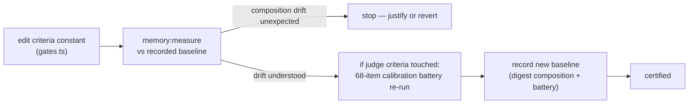

# Phase 7 · Measurement & operations

**Status:** shipped · **Concepts you need:** the five
[gates](reading-guide.md#glossary) and the
[digest](reading-guide.md#glossary) · **Last verified:** 2026-11

---

## Goal

Make the memory system *certifiable*: any criteria change, encoder change, or
schema change has a defined way to verify the pipeline still behaves — and
the operational lessons from real incidents are wired into how we run it.

## The tools

| Tool | What it does | When |
|---|---|---|
| `pnpm run memory:check` | Subsystem probe: PART A local (SQLite-vec shim behavior — runs **without credentials**) | after schema/substrate changes |
| `pnpm run memory:measure` | Exercises the **real** memory path against the real store: digest composition, value-gate measurement (30 fact / 1280-token budgets), retrieval stats | after criteria or encoder changes |
| `/memory` panel + logs | Digest composition, pending jobs, automation outcomes | routine ops |

`verify-measure.ts` exists because "we ran a few test pairs" is not a
result (the eval methodology docs baked this stance in, pre-registered):
measurements go through the real capture→gate→inject path, and outputs are
composition numbers, not vibes.

## Operational lessons on record

1. **October gateway outage (capture starvation).** Embedding endpoint
   silently 401'd for days → 22 capture jobs backlogged → the 7-day sweep
   nearly destroyed them. *Lesson:* embeddings and store writes are
   capture-path dependencies; backlog-age needs alerting, and per-endpoint
   credentials should not silently couple ([`01-capture.md`](01-capture.md)
   failure modes).
2. **Long-batch LLM calls stall.** During the LoCoMo dreaming run, repair
   calls hung (one 45-minute stall) and one returned empty JSON. *Lesson:*
   every batched LLM call needs **timeout + retry + incremental result
   flushing**; patterns live in the study scripts
   (`.kimchi/docs/locomo-*.json`).
3. **Criteria changes are behavioral changes.** Verbatim-pinned criteria
   (ADR 003) mean an edit is a new gate; the regression protocol is:
   re-run `memory:measure`, compare digest composition against the recorded
   baseline, and re-run the dreaming-era calibration battery when the change
   touches the judge criteria.

## Regression protocol (criteria change)

## Failure modes on record

- Silent capture starvation (lesson 1).
- Stall-without-timeout on long LLM batches (lesson 2).
- Baseline drift gone unrecorded (why this page has a protocol at all).

## Code pointers

`verify-measure.ts` (real-path measurement) · `backend.check.ts` (PART A
local; PART B requires credentials — **never** part of a docs or book gate)
· `package.json` scripts `memory:check` / `memory:measure`.

## Open items

- Backlog-age alerting (from lesson 1).
- Automating the digest-value metric into a periodic run.
- Book-level checks: the docs-check script and maintenance triggers live in
  [`appendix.md`](appendix.md) / [`maintenance.md`](maintenance.md).

---

This completes Part II. Part III lifts these seven phases into the hosted
platform: [`10-platform-scopes.md`](10-platform-scopes.md).
