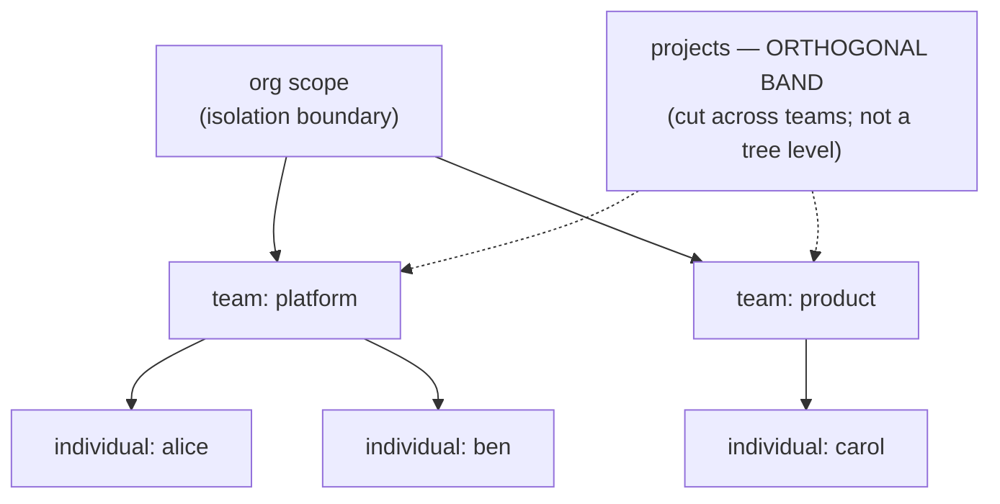

# Platform · Scopes: org → team, projects cross-cutting

> **Status: PROPOSED.** Elements marked *existing* pin to running code;
> everything else is design.

**Concepts you need:** [scope, org attribution](reading-guide.md#glossary) ·
**Last verified:** 2026-11

---

## Goal

Give memory the same shape orgs already give code: clear ownership, clear
sharing boundaries, inheritance you can predict.

## The model (user-ratified)

- **Tree:** org → team → individual. Upper scopes inherit the union of what
  their children have distilled upward; a memory anchored at a level inherits
  to everyone *under* it.
- **Projects are not a level.** A project (e.g. "infra-refresh") crosses
  teams; it is an orthogonal *band* — a tag whose visibility is whoever is
  attached to the project, independent of the team tree. (This was a real
  fork in the design: strict `project ∈ team ∈ org` nesting was rejected
  because it forbids cross-team projects.)
- **Isolation:** a query never leaves its org scope; within an org, visibility
  follows the tree plus the project band.

## What exists today (*existing* pins)

| Mechanism | File | What it already does |
|---|---|---|
| Org attribution header | `src/auth/gateway-credentials.ts` | Credentials resolution for gateway calls carrying org identity |
| Org-scoped endpoints | `src/api/organizations.ts`, `org-settings.ts`, `me.ts` | Org surface with the `GATEWAY_ORGANIZATION_HEADER` |
| Org policy master | `src/org-policy.ts` | Org-level policy held per session |
| Per-resource toggles | `src/resources/store.ts` (`isResourceEnabled`) | Whether a resource is on for the org |
| Permission helpers | `src/extensions/permissions/` | Mode/policy classification for commands |
| Telemetry policy | `src/telemetry-policy.ts` | Effective usage-reporting config per org |

*Proposed extensions:* the platform adds team/individual scope anchors and the
project band onto the org-attributed pipeline; the local `personal`/`agent`
scopes ([`02-storage.md`](02-storage.md)) map to **individual** and **project**
respectively in the migration ([`13-migration.md`](13-migration.md)).

## Worked example

Org `acme` has teams `platform` and `product`; project `mobile-app` spans
both. Alice (platform) and Carol (product) are both on `mobile-app`.

- Alice's local private memory → **individual/alice** (never shared upward;
  only its k-anonymous distillates are).
- The team-learned gotcha ("deploy job OOMs above 3 workers") → **team/platform**
  → inherits to org if distilled; visible to Ben; not Carol — unless it was
  captured while attached to `mobile-app`, in which case the **project band**
  carries it to Carol too.
- Org-wide standards ("never commit `.env`") → **org** scope, inherited by all.

## Guarantees & rules (proposed)

1. A memory exists in exactly one anchor scope, plus optional project bands.
2. Upward movement only via [shared distillation](11-shared-distillation.md)
   (k-anonymity enforced per atomic claim).
3. Splits/deprecations are administrative operations, not judgments —
   no LLM decides scope membership.
4. Org boundary is hard: all platform calls carry org attribution from the
   existing gateway surface; nothing crosses orgs, period (verified in
   [`14-threat-model.md`](14-threat-model.md)).

## Code pointers (existing)

`src/auth/gateway-credentials.ts` · `src/api/organizations.ts`,
`org-settings.ts`, `me.ts` · `src/org-policy.ts` ·
`src/resources/store.ts` · `src/extensions/permissions/` ·
`src/telemetry-policy.ts` · local counterpart `src/extensions/memory/scope.ts`.

## Open items

- Project-band storage layout (junction table vs embedded tags) — storage
  design chunk when the platform is scheduled.
- Team remap on reorgs (move subtree; band references stay stable).
