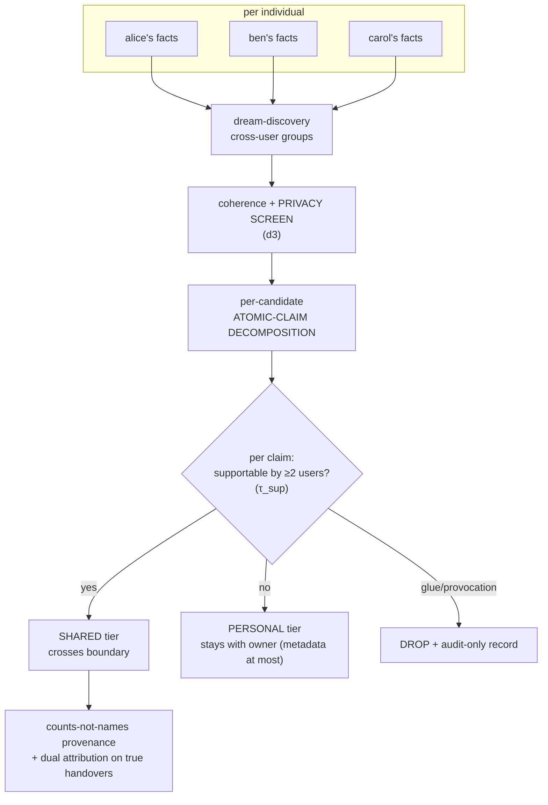

# Platform · Shared distillation

> **Status: PROPOSED design — every rule here is backed by *measured*
> evidence from the research studies (whitepaper §5.12, §8).**

**Concepts you need:** [k-anonymity per claim, SUPPORT/PERSONAL/DROP tiers,
counts-not-names provenance, dreaming](reading-guide.md#glossary),
[`06-dreaming.md`](06-dreaming.md) · **Last verified:** 2026-11

---

## Goal

Distill memories that are safe to share *between users* — handover knowledge,
shared environment facts, team practice — without ever leaking one person's
private traits across the boundary.

## The ladder

## The three rules and their measured basis

1. **k-anonymity is per ATOMIC CLAIM, not per group.** A candidate is
   decomposed first ("Dave's reviews slipped twice this sprint"
   → [Dave is a reviewer], [his reviews slipped], [twice this sprint]); each
   claim needs ≥2-user support at τ_sup = μ₀+4σ₀. *Measured necessity:* a
   "whole group contains two users" rule incorrectly SHARED a
   handover-shaped toxic composite (§5.12 initial run). Re-run with claim
   decomposition: claim-level 35 entailed / 10 plausible / 1 unsupported
   across 46 claims.
2. **The privacy screen runs before distillation, and it is layered.**
   *Measured:* the d3 screen caught one toxic group; a second
   (provocateur-shaped) slipped through and was **contained to PERSONAL by
   the per-claim support audit** — a two-layer catch, by design (§5.12).
3. **Crossing requires entailed.** Only judge-certified claims become
   SHARED. The measured cost of even *admitting* the plausible tier to
   retrieval: +1.7 adversarial false-answer points on LoCoMo multi-hop
   (§5.13) — the reason `require_entailed_for_crossings` is on by default.

## Handover is the canonical SHARED shape

The clean cross-user case: two engineers genuinely share a fact ("service X
uses a nightly batch"). Measured behavior: the dual-provenance dedupe
recovers the equivalent memory (sim 0.854 in the seeded run) and merges it
with **both users' support** — provenance recorded as *counts*: "2 users",
never "alice + ben".

## What precedent looks like

Clio (Anthropic) showed consolidated cluster insights are materially
quote-safer than raw logs; our ladder goes one stricter: no user content at
all crosses — only verified, claim-level-supported distillates with count
provenance (whitepaper §8).

## Guarantees (proposed, evidence-backed)

- No raw session content ever crosses a user boundary.
- Handover mergers preserve dual support; trait composites do not cross.
- Every distillation decision (SHARED/PERSONAL/DROP + why) is written to an
  audit log readable per user.

## Code pointers

None (platform work). Adjacent existing: supersede/judged patterns
(`supersede.ts`), gate batching (`decision-gate.ts`), dreaming battery
protocol (whitepaper §3).

## Open items

- `min_support_users` beyond 2 for sensitive scopes?
- Provenance counts on supersession chains (a deleted claim's contribution
  to k-anonymity).
