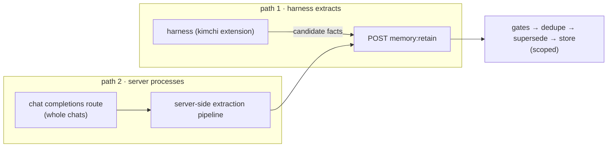

# Platform · REST API

> **Status: PROPOSED.** The host/routing/auth patterns below are *retained*
> from existing, production-proven design work; the memory endpoints
> themselves are *new* design.

**Concepts you need:** [scopes](10-platform-scopes.md),
[org attribution](reading-guide.md#glossary) · **Last verified:** 2026-11

---

## Goal

One REST surface that every harness (and any future UI) talks to for memory:
retain facts, recall them, ask judgment questions, and poll dream status —
with org isolation inherited from the existing gateway patterns.

## Retained base (existing, do not redesign)

From the platform-API design record (issue-body/pr-body/commit-msg +
endpoint probes):

- **Host & routing:** CLI API traffic resolves to the API origin
  (`api.cast.ai` / `api.eu.cast.ai`) directly — production-proven by
  `src/extensions/stats/api.ts`; console host (`app.kimchi.dev`) serves UI
  only, with `KIMCHI_REMOTE_ENDPOINT` as the dev escape hatch.
- **Auth:** Bearer + SSO org-routing header — the same pattern
  `src/api/me.ts`, `src/api/org-settings.ts` already use via
  `GATEWAY_ORGANIZATION_HEADER` (`src/auth/gateway-credentials.ts`).
- **Org surface:** `/v1/organizations/{id}` and
  `.../organizations/{org}/settings:resolve` exist; memory rides the same
  attribution, no new identity primitive.

**Retained caution (gateway interop):** harnesses consuming the LLM gateway
must not inject request shapes the upstream can't serve (recorded interop
failure: codex's built-in `web_search` tool — codex-gateway-ticket). Memory
API calls themselves are plain REST and unaffected.

## New design: the memory endpoints (sketch)

| Endpoint | Shape | Notes |
|---|---|---|
| `POST /v1/memory:retain` | `{scope, project?, facts[]}` → `{accepted, deduped}` | Facts are distilled **client-side or via ingestion path 2**; server runs gates + dedupe + supersede |
| `POST /v1/memory:recall` | `{scope, query, k?, filters?}` → `{facts[], whyEmpty?}` | The value gate is server-side; an empty recall is a first-class answer |
| `POST /v1/memory:judge` | `{state, questions[]}` | d3 syllogism-style gate as a service (64-question cap applies) |
| `GET /v1/memory/dream-status` | `{scope}` → `{pending, lastRun, vetted, tiers}` | Dreaming runs offline; this is the observability seam |
| **MCP** | *deferred (plan proposal)* | A thin adapter over the above is documented as out-of-v1; revisit only if a dedicated memory-search tool proves necessary |

## Two ingestion paths (user-ratified)

Path 1 keeps extraction near the source (harnesses already do it); path 2
lets any chat client gain memory by routing completions through the gateway —
no client changes needed.

## Injection (symmetric)

Recall results return via API response; harnesses compose them into context
(respecting display budgets — [`05-retrieval.md`](05-retrieval.md)). An
*automatic* composition mode (server-side injection into the completions
request, matching path 2) is the zero-client-change variant; both are
design-level options, not yet chosen.

## Embedding-config uniformity (hard rule)

All org-scoped stores share **one** embedding configuration per deployment.
Vetted memories are meaningful only within the moments of the encoder that
created them (ADR 005); org policy prevents per-user encoder drift — the
migration relies on this ([`13-migration.md`](13-migration.md)).

## Offline posture

Dreaming stays offline (ADR 008): jobs run on a schedule server-side;
clients only ever read `dream-status` and the vetted results. Rate/cost is
therefore bounded by schedule, not by user traffic.

## Code pointers (retained)

`src/api/me.ts`, `src/api/org-settings.ts`, `src/api/organizations.ts`,
`src/auth/gateway-credentials.ts`, `src/extensions/stats/api.ts`.

## Open items

- Automatic-injection vs response-only as the v1 injection mode.
- The name/prefix of the memory route family (`/v1/memory:*` is a sketch).
- Bulk endpoints for migration ([`13-migration.md`](13-migration.md)).
