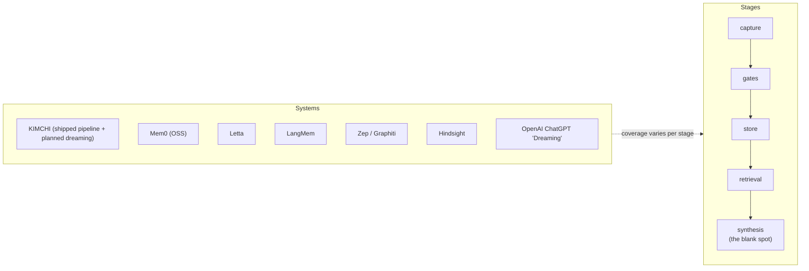

# Competitive landscape

**Status:** shipped analysis · **Concepts you need:** the
[six standard operations](primer.md#glossary) · **Last verified:** 2026-11
· **Full detail with citations:** `docs/research/memory-dreaming-whitepaper.md` §6

Who else builds agent memory, which lifecycle stages each covers, and what
this system's deltas are. Source of every claim: the whitepaper's §6, whose
information-access note applies — vendor docs over repo-inspections where
source is unavailable.

---

## The comparison unit

Every system below is compared against **Kimchi's whole shipped memory
pipeline** — capture → extraction → five gates → store → retrieval — not
against the whitepaper's dreaming research alone. Ships means: in
`src/extensions/memory/` today. Where a capability is inherited from that
pipeline rather than the dreaming research, the table says so.

## Mechanism table

| System | Self-improvement | Synthesis discovery | Geometric/semantic triggers | Independent verification | Truth tiers | Cross-user distillation | Judging |
|---|---|---|---|---|---|---|---|
| ChatGPT "dreaming" (OpenAI) | offline synthesis jobs | not public | not public | not described | no | unknown (consumer anecdote) | not described |
| Letta | sleep-time agents | fixed temporal/sharing triggers | no | no | no | shared-memory blocks | LLM agents |
| LangMem | background manager | none (prompt-level ops) | no | no | no | graph namespaces | LLM prompt |
| Zep / Graphiti | hybrid episodic→semantic w/ temporal | temporal edges + community detection | community structure | no | invalidation edge (bi-temporal) | graphs | LLM edge extraction |
| Mem0 | none (flat add/search/update/delete) | none | no | no | no | no | LLM resolver (ADD/UPDATE/DELETE/NONE) |
| Memobase | profile-merge | fixed flush + profile merge | no | no | no | profile slots | LLM merge |
| Hindsight | consolidation + observation extraction | fixed consolidation triggers | no | no | observations w/ evidence quotes + proof counts (re-derivable) | bank isolation + entity resolution | observations are quotes; hs-decide for ops |
| **This book's full pipeline** | **dreaming proposed on top of shipped capture/gates/store** | **similarity-coupling discovery + LLM split/repair** | **sphere z-scores, τ_sup = μ₀+4σ₀, d3 coherence screen** | **d3 syllogism battery + judge calibration (68 items, 0-of-24 FAR); 840/0** | **entailed / plausible / rejected (labels kept)** | **proposed in §11 (k-anonymity × atomic claims)** | **inherited production gates; dreaming battery new** |

## Landscape positions (details and open questions per system: whitepaper §6.2)

- **OpenAI dreaming** — offline jobs synthesizing user models; the genre
  Kimchi dreaming belongs to. No published mechanism or eval numbers.
- **Letta** — the closest shipped relative: a sleep-time pass reorganizes
  memory outside hot path. **Deltas:** Kimchi adds offline trigger discovery
  (not fixed timers), independent verification, truth tiers, and scoped
  sharing.
- **LangMem** — pure prompt-level ops toolkit; no verification at all.
- **Zep / Graphiti** — best temporal machinery in OSS (bi-temporal
  invalidation). **Deltas:** Kimchi carriers tiers on facts; dreaming's
  discovery is similarity-driven rather than community-driven; verification
  is judge-backed.
- **Mem0** — the current substrate here (wrapped with the supersede patch).
  Flat add/search/update with an LLM conflict resolver; no synthesis.
- **Memobase** — profile-slot merging; fixed triggers only.
- **Hindsight** (vectorize-io; arXiv 2512.12818) — the most interesting
  2025 OSS entry: observations carry verbatim evidence quotes with proof
  counts (re-derivable provenance — a real verifiability step), plus mental
  models, bank isolation, and a regex PII layer. **Deltas:** no independent
  judge of synthesized statements, no truth tiers, no k-anonymity; its PII
  defense is at retain-time (per-item) while this book's platform target is
  synthesis-time (per-crossing). Both are in the threat model
  ([`14-threat-model.md`](14-threat-model.md)).

## Numbers with honest tags

Levels are not comparable across harnesses — the same product's LoCoMo J
score spans 65.99 vs 75.14 across two published runs (third-party vs
self-reported). **Only our own runs produce level claims**: retrieval with
vetted dreams lifts multi-hop QA +6.4 points (p≈0.008) on LoCoMo; precision
840/0 across 5 studies; judge calibration 0-of-24 adversarial FAR. Self-
reported competitor figures (Mem0 66→93 per harness; Hindsight LongMemEval
SOTA, independently reproduced) are tagged as such in the whitepaper.

## What is actually new here (architecture, not levels)

1. **Discovered trigger** — geometry proposes groups (mutual-kNN + pre-split +
   LLM boundary repair), rather than cron triggers or human rules.
2. **Independent judge** — d3 syllogism battery decides entailment, not the
   synthesizer's own paraphrase drift.
3. **Truth tiers** — entailed vs plausible are labels on the memory, not
   an overwrite queue.
4. **Cross-user design with measured toxicology** — per-atomic-claim
   k-anonymity + privacy screen, with an adversarial battery and a privacy
   hit on record. Proposed in Part III.

**Open items:** no protocol-matched level runs against competitors (their
harness dominates their measured deltas); entailed-only retrieval ablation
pending (cost measured at +1.7 adversarial points — see
[`06-dreaming.md`](06-dreaming.md)).

**Terminology:** [glossary](reading-guide.md#glossary) (truth tiers,
k-anonymity, supersede, …).

**Next:** [`decisions.md`](decisions.md) — why the local system is built
this way.
