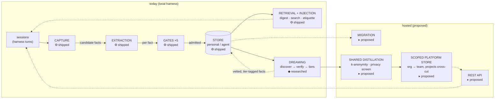
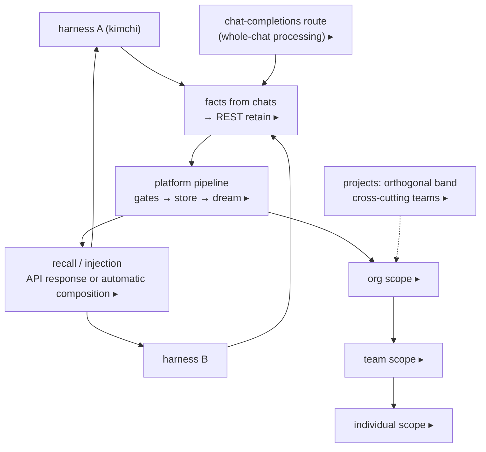

# The memory lifecycle spine

**Status:** mixed — every element is labeled · **Concepts you need:**
[fact](reading-guide.md#glossary), [gate](reading-guide.md#glossary),
[embedding](reading-guide.md#glossary) · **Last verified:** 2026-11

One diagram for the whole system. Everything else in this book is a zoom of
one of these stages.

---

## The spine

Legend: **⚙ shipped** = works in `src/extensions/memory/` today ·
**◆ researched** = fully specified and measured, no implementation ·
**▸ proposed** = hosted-platform design.

## Reading the spine left to right

1. **Sessions** are the raw material. Nothing enters memory except through
   capture points.
2. **Capture** ([`01-capture.md`](01-capture.md), ⚙) snapshots the session at
   moments where content would otherwise be lost — before compaction and at
   shutdown — and files durable jobs.
3. **Extraction** ([`01-capture.md`](01-capture.md), ⚙) is the LLM pass that
   turns windows of text into atomic candidate facts under pinned criteria.
4. **Gates** ([`03-gates.md`](03-gates.md), ⚙) are five quality checks
   (triage, value, conflict, stale, supersede) answered by the decision model
   d3. Admitted ≠ true: gates block noise, not certify truth.
5. **Store** ([`02-storage.md`](02-storage.md), ⚙) is a flat, bge-m3-embedded
   fact table per scope (today: `personal` and `agent`).
6. **Retrieval + injection** ([`05-retrieval.md`](05-retrieval.md), ⚙) decides
   what reaches the model: the startup digest, gated search results, memory
   etiquette. All flows are budget-controlled by residency rules.
7. **Dreaming** ([`06-dreaming.md`](06-dreaming.md), ◆) scans the store
   offline, discovers groups of related facts, synthesizes new facts they
   imply, and admits only verified ones — tagged by truth tier.
8. **Hosted overlay** ([Part III]) (▸): migration carries the store's vetted,
   provenance-tagged facts into a scoped platform; shared distillation merges
   across users under k-anonymity; a REST API serves every harness.

## The hosted overlay on the same spine

Two ingestion paths (extracted facts via the retain API, or whole chats via
the chat-completions route), one shared pipeline, a strict scope tree with
projects as a cross-cutting dimension, and symmetric output. Details:
[`10-platform-scopes.md`](10-platform-scopes.md),
[`12-platform-api.md`](12-platform-api.md).

## Guarantees worth remembering

- **Capture:** nothing from compaction or shutdown is silently dropped —
  the pre-compact capture point exists because transcripts there are deleted
  unrecoverably ([`01-capture.md`](01-capture.md)).
- **Gates:** the store is protected from ~66% of transient junk the raw
  extractor would emit (decision-model spike, E2).
- **Dreaming:** 840 synthesized candidates judged across five studies, 0
  unsupported ([`06-dreaming.md`](06-dreaming.md), ledger).
- **Everything unimplemented is labeled** ◆ or ▸ — nowhere does this book
  describe research or proposals as if they were running code.

## Failure modes on record

- Redundancy is the dominant store pathology (~10% paraphrase pairs; 17/48
  facts redundant in the spike-era store). Motivates dedupe-first dreaming.
- Thresholds die when the encoder changes (the 0.2-score incident) — all
  thresholds in this system are measured per-distribution.
- Capture silently starves when the embedding endpoint breaks (October
  outage; 22-job backlog). Captured in [`07-measurement.md`](07-measurement.md).

## Code pointers

Spine→files: `capture.ts`, `capture-worker.ts` (capture/extraction) ·
`gates.ts`, `decision-gate.ts` (gates) · `backend.ts`, `embedder.ts`,
`scope.ts` (store) · `inject.ts`, `memory-panel.ts`, `scoped-searcher.ts`
(retrieval) · `verify-measure.ts`, `backend.check.ts` (measurement).

**Next:** [`landscape.md`](landscape.md) — who else builds memory, and how
they differ.
