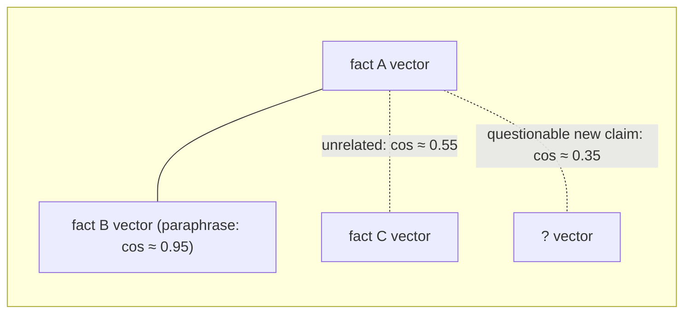

# Primer: how agent memory systems work

**Status:** shipped reference · **Concepts you need:** none — this is the first
chapter · **Last verified:** 2026-11

If you have never thought about how an agent's long-term memory *should* work,
this is the chapter that gets you there. It teaches the general field —
vocabulary, standard operations, storage shapes — using tiny examples. Every
later page assumes you have read this once.

---

## 1. What agent memory is

An agent runs many sessions. Between sessions, the context window empties.
Anything the agent needs tomorrow — your preferences, your stack, the gotchas
from last week — has to live somewhere durable. That durable thing is the
**memory store**, and it is deliberately *not* the chat transcript:

- The transcript is the raw record — long, conversational, mostly noise.
- The memory store is the distilled record — short **facts**, each one
  self-contained.

Example. After a debugging session, the transcript is 400 lines. The memory
store adds one line:

> `Service auth0 callback fails unless the trailing slash is present.`

Tomorrow's session starts with that fact in context instead of a rediscovery.
The pipeline from transcript to fact is **capture**; the fact itself is the
atomic unit everything else operates on.

## 2. Why a flat store is not enough

The obvious implementation is "append every captured fact to a list and search
it later." Research and our own measurements show three ways that fails:

1. **Redundancy.** Agents capture near-duplicates aggressively. In the real
   store used for evaluating this system, about 10% of the store was explicit
   paraphrase pairs — two rows saying the same thing with different wording.
   Retrieval now spends its budget repeating itself.
2. **Drift.** Facts age. "We use Webpack" is true in March and false in
   September. Without an **update** operation, search returns both versions
   and the model has to arbitrate stale conflicts at answer time.
3. **No inference.** A flat store can only return what was explicitly
   written. Yet people routinely *imply* things they never state: three
   sessions each mention shipping with Docker; nobody writes "this project is
   dockerized." The insight is in the data but unreachable by any search.

The whole field, and this book, is about the machinery that fixes these three
problems.

## 3. The standard operations

The survey taxonomy (Hu et al., 2025) names six operations. Each maps to a
concrete page in this book:

| Operation | What it does | Tiny example | Where in this book |
|---|---|---|---|
| **Extraction** | Selects what is worth keeping from raw material | 400 transcript lines → 1 fact | [`01-capture.md`](01-capture.md) |
| **Indexing** | Makes items findable | store an embedding per fact | [`02-storage.md`](02-storage.md) |
| **Update** | Replaces the outdated with the current | "uses Webpack" → "uses Vite" | [`04-supersede.md`](04-supersede.md) |
| **Forgetting** | Removes low-value or stale items | delete the "temporary" | [`04-supersede.md`](04-supersede.md) |
| **Retrieval** | Fetches what is relevant right now | "auth bug" → the auth0 fact | [`05-retrieval.md`](05-retrieval.md) |
| **Consolidation** | Merges several items into one durable summary | 3 Docker facts → "dockerized" | [`06-dreaming.md`](06-dreaming.md) |
| *(Condensation)* | *Keeps a short representation of the raw transcript* | *the digest* | *[`05-retrieval.md`](05-retrieval.md)* |

Two of the deeper ideas, used everywhere:

**Gates and judges.** Every operation that *writes* to the store needs a
quality check, because the LLM doing extraction makes mistakes. So each
candidate passes through a **gate** — a small, typed question answered by a
decision **judge** model ("Does this statement express a durable preference?
yes/no"). Gates stop bad writes. They do not prove facts true, and that
distinction matters later (see [`03-gates.md`](03-gates.md)).

**Verification.** Some operations *can* be checked precisely instead of merely
screened. When a new fact claims to summarize old ones, you can ask "do the
old ones actually entail this?" — and score the answer. Operations with
verifiable output deserve proof or measurement, not vibes. That is the reason
this book has a formal appendix at all.

## 4. How stores remember similarity: embeddings in five lines

1. An **embedding model** maps text → a vector of numbers (here: 1024 of them).
2. The encoder is *contrastive*: trained so paraphrases land close together.
3. So **cosine similarity** between two vectors ≈ semantic similarity between
   two facts. Range [-1, 1]; identical meaning ≈ 1.0.
4. All vectors here are unit-normalized: they live on a **sphere**, and
   similarity is the cosine of the angle between them.
5. Crucially, *unrelated* facts do **not** land near 0 — they cluster around
   ~0.5. Every threshold in this book is therefore measured against a
   background distribution, never assumed. (This is called *anisotropy*, and
   it is the single most common mistake in naive vector search.)

The sphere picture, kept as the mental model throughout:

Distances on this sphere are not uniform — around a cluster of real facts
there is a *landing band* where honest consolidations live and a *penumbra*
where plausible inferences live. Measuring those bands precisely is what
[`06-dreaming.md`](06-dreaming.md) and
[`appendix-formal.md`](appendix-formal.md) are about.

## 5. Store shapes people actually build

| Shape | How it works | Strength | Weakness |
|---|---|---|---|
| **Flat vector store** | Embed each fact; nearest-neighbor search at query time | Simple, fast, predictable | No structure: redundancy, drift, no inference |
| **Graph store** | Entities as nodes, relations as edges, extracted at write time | Multi-hop queries ("who manages Alice's teammate?") | Complex to build/maintain; temporal edges need dating; dedupe is hard |
| **Hybrid** | Vector store for search + overlays (graphs, profiles) on top | Gets structure without giving up search | Two systems to keep coherent |

Most production systems are hybrids of some kind. Kimchi's shipped store is
deliberately the flat one — simple and inspectable — while the novel work in
this book builds *derived structure on top* of it rather than replacing it:
dreaming discovers and labels structure (Part II), and the platform layers
scopes on top (Part III). You will see in [`decisions.md`](decisions.md)
exactly why that order was chosen.

## 6. The question this book answers

We now have the vocabulary to state it precisely:

> Given a growing store of distilled facts, can we automatically —
> and provably safely — (a) keep it clean (update, forget, deduplicate),
> (b) keep it cheap (condense to a digest), and (c) grow knowledge beyond
> what was ever explicitly stated (consolidation, inference),
> first for one user, then across teams?

Part I draws the whole pipeline in one diagram and places today's competitors
on it. Part II walks the seven phases of the local implementation, one page
each, with the guarantees and measured failures of each. Part III is the
design for the hosted, multi-scope platform. The proofs are in
[`appendix-formal.md`](appendix-formal.md); every measurement is indexed in
[`appendix.md`](appendix.md).

**Terminology:** every memory term in this chapter is defined in the
[glossary](reading-guide.md#glossary).

**Continue to:** [`overview.md`](overview.md) — the lifecycle spine.
