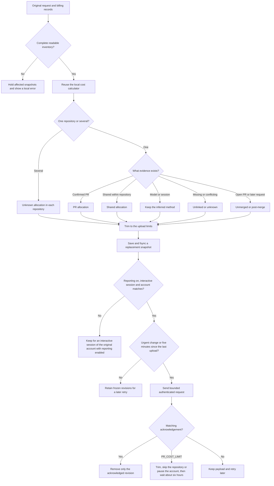
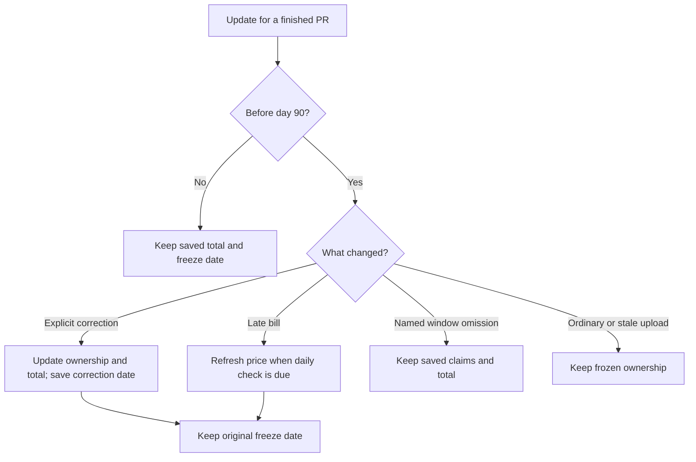

# PR cost reporting

PR cost reporting follows the SaaS telemetry setting by default. When SaaS uploads are on, Kimchi reports existing work automatically, including requests made before a PR exists. An explicit `/pr-reporting on` or `off` overrides that default and survives restart. Existing saved choices are preserved.

The first interactive main session shows one notice that PR costs are reported, with `/pr-reporting off` to disable it. Studio shows it as a notification after the first turn, because notifications sent before a session is registered are dropped. The notice is saved per installation and does not repeat after restart. It is skipped when reporting is off or the user already made an explicit choice.

- `/pr-reporting on` enables uploads for the verified account and requests an immediate update. It resets retry scheduling for event batches and retained legacy snapshots.
- `/pr-reporting status` shows the saved choice, whether this session uploads, queued and acknowledged events, frozen batches, retry time and last event acknowledgement. Legacy repository counts and limits remain separate. Delivery problems come first and make the message a warning, including saved event failures after capture resumes successfully. Incomplete history alone is informational. Counts cover the local queues across accounts; sending still requires verification of their original account. Status does not freeze or send batches. Lines fit a 60-column terminal.
- `/pr-reporting off` cancels delivery and retains pending payloads locally for a later retry. Local work history and revision counters remain. Reports already accepted by the server remain there.

Typing `/pr-reporting ` suggests `on`, `off` and `status`.

For example:

```text
Delivery problems
- PR cost reporting paused for this organization:
  organization limit reached (requests 50,000 of 50,000).
  Ask an admin to free space or wait.
  Next try in about 5 h.
- owner/repo is partially reported: 1,200 requests left
  out to fit the upload limits.

PR reporting   Enabled (SaaS default)
This session   No uploads; local attribution continues
               Reason: CI environment (GITHUB_ACTIONS)
Repositories   2 queued · 3 acknowledged
               1 waiting for the 5-minute upload window

History coverage incomplete
  3,693 requests skipped without original account or
  repository evidence. Other requests are still reported.
```

Only main sessions with work tracking run this extension. Child sessions contribute their existing request records through the local calculator; they do not start upload workers. Turning Cost per PR off in `/resources` turns off work tracking, PR/MR status and reporting together.

The existing reconciliation worker captures local history at startup, after agent turns and every 30 seconds while Kimchi runs. New observations become revisioned events in the same SQLite database as work tracking. There is no separate daemon or model call for delivery. A request can appear as unlinked or unknown, then acquire a PR or price through a later revision without adding the same charge again.

New capture does not create legacy repository snapshots. Before an account can send events, its older pending snapshots must drain through their original endpoint with their original bytes. Backoff, held snapshots and unfinished scans keep that gate closed. A change still queued when Kimchi exits remains durable for the next session.

## Current event uploads

Kimchi sends `POST /ai-optimizer/v1beta/organizations/{organizationId}/pr-cost-events:batchIngest`, using the reporting Kimchi API key. Inference can use a different endpoint and provider. Each frozen body is `{"batch":{...}}`; the acknowledgement is a flat object containing `batchId` and complete per-event receipts. SQLite advances only the acknowledged persisted bytes. Lost, invalid or partial acknowledgements retain the batch for replay.

Uploads include only facts available in the captured records:

- Physical request IDs, observed model/provider usage and reported cache/iteration counters, source version and completeness. Missing attempts, counters, pricing dimensions or catalog rates remain unknown.
- Work metadata and allocation from the existing calculator, repository/PR metadata and Jira issue references. Work/session/device and plan/file identities use opaque identifiers; an explicit work title and provider PR title/login can be included.
- Terminal tool category, outcome and duration when observed, plus captured file revision transitions. Filesystem observation windows remain ambiguous about which process changed a file.
- Observed plan revision identities, Git commit SHAs and explicit coverage gaps. Raw plan hashes, local paths, prompts, plan contents, file contents, tool arguments/results and credentials are not sent.
- Genuine billing aliases when available. Authentication establishes the contributor; the harness source is retained separately. Shared credentials cannot distinguish people.

Direct-provider costs are server-side rate-card estimates when usage and pricing dimensions suffice. These are distinct from verified Cast billing rows; a matching owned bill can replace an estimate. Missing usage is not zero, and observing a response does not prove that hidden gateway retries or negotiated prices are known. Tool/file links do not establish an exact dollar allocation per file. Server deployment and the supported harness capture surfaces still bound what a report can show.

The outbox freezes at most 100 events and 1 MiB per batch. Revisions preserve their prior identity and hashes; ambiguous or unsupported records keep their translation intent instead of being discarded. Empty queues and batches whose retry is still in the future make no authentication request. A candidate send freshly verifies the key/account and rechecks consent and lease ownership. Pending state and retries survive restart. No proxy metrics are required.

### Sessions that never upload

CI jobs, one-shot runs and benchmarks would only add noise, so they keep recording and attributing work locally but skip the reporting pass and never upload. A later interactive session on the same machine builds and sends the same reports from those records. `/pr-reporting status` names the reason:

- `KIMCHI_PR_COST_REPORTING=0` (also `false`, `off` or `no`) turns uploads off for the process, whatever the saved choice.
- `--print`/`-p` and `--mode json` runs, including piped input, which Pi runs in print mode. Interactive TUI, Studio (ACP) and RPC sessions upload.
- CI: any of `CI`, `GITHUB_ACTIONS`, `GITLAB_CI`, `BUILDKITE`, `JENKINS_URL`, `TEAMCITY_VERSION`, `CIRCLECI` or `TF_BUILD` set to a value other than empty, `0`, `false`, `off` or `no`.
- Benchmark runs, recognized by a positive `KIMCHI_INFRA_BREAKER_THRESHOLD`; only the benchmark harness and CI set it.

The saved choice and the default-on notice are unaffected; nothing overrides the detection to force uploads.

Teleport transfers conversation history but does not transfer the local accounting journals or account scope. On a fresh sandbox, normal continuation starts a new work on the first input. An explicitly selected work keeps its ID, but its missing scope remains unknown. Neither case establishes a complete cost across local and remote work. Remote-agent accounting is outside this reporting change.

## Retained legacy snapshot format

The remainder of this section describes old snapshot bodies that this version preserves and drains. It does not describe new event capture.

Each upload replaces one producer's inventory for one account and repository. It contains:

- The Git provider, host, stable target repository ID, and optional repository name.
- Stable PR/MR IDs, numbers, links, state and merge or close times.
- Each PR/MR's `title` and `author` login, as the provider returned them to PR discovery, so the console can name the PR. A title is cut to 1,024 characters. An unknown or empty value, or a login longer than 255 characters, is left out rather than sent empty or cut.
- Each PR/MR's `issueKeys`, so Kimchi counts its cost for its Jira issues: the issue chosen with `/work issue` for the work whose requests went to it (`work`), then the Jira keys its head branch names (`branch`), at most 20. Only the keys are sent, never the branch name. A PR without keys leaves the field out. The backend reads keys in titles itself.
- Exact request attempt UUIDs, verified billing-row UUIDs and request start times.
- Allocation kind, referenced PR IDs and evidence method. An `unknown` request names the PRs it may belong to, so only those totals stay incomplete. An input whose native edits landed in the PR sends `native`; other session inputs send `session` and stay inferred. Continued plans send `explicit`; `/work link` corrections send `user-correction`. Model guesses send `model` and stay inferred.
- Request counts, missing-price counts, history completeness and the latest applicable cost refresh time.

Optional fields explain later updates. `windowedPullRequestIds` lists finished PRs deliberately left out of this upload. A request's `correction` contains the validated link's UUID, revision, time and source (`work-command` or `producer-confirmation`). The source distinguishes an explicit `/work link` or `/work unlink` from a verified saved-plan or artifact confirmation. `coverage.trimmedRequests` counts requests left out to fit the upload limits; it appears only when some were, and then `historyComplete` is `false`.

Kimchi does not upload prompts, plans, messages, local paths, work IDs, session IDs, commit hashes, credential fingerprints or prices. The backend reads its own billing rows. A request without a confirmed price remains in the inventory; it is not reported as free. Authentication determines the contributor; the body has no user field.

An upload with one request still waiting for billing looks like this:

```json
{
  "schemaVersion": 1,
  "producerId": "11111111-1111-4111-8111-111111111111",
  "revision": "3",
  "generatedAt": "2026-10-05T12:00:00.000Z",
  "repository": { "provider": "github", "host": "github.com", "id": "42", "name": "example/repo" },
  "pullRequests": [],
  "requests": [{
    "requestId": "22222222-2222-4222-8222-222222222222",
    "billingRecordIds": [],
    "startedAt": "2026-10-05T11:59:00.000Z",
    "allocation": { "kind": "unknown", "pullRequestIds": [], "method": "session" }
  }],
  "coverage": { "observedRequests": 1, "unpricedRequests": 1, "historyComplete": true }
}
```

## Legacy snapshot matching and delivery



GitHub IDs come from the PR's `id` and target `base.repo.id`. GitLab IDs come from the MR's `id` and `target_project_id`. A fork's source repository ID never replaces the target ID. Old merged links without these IDs are refreshed.

The inventory comes from the original journals through the same billing validation and calculator used by local cost summaries. It does not concatenate per-work `costs.json` files. Two works contributing to one PR do not duplicate requests. Cross-repository shared requests are reported as unknown in each repository; the backend handles duplicate billing evidence across snapshots. A request that starts after several PRs merged keeps all candidate IDs as a shared claim. The backend compares its start time with each merge time and places it outside those PR totals.

Records without their original account or repository are skipped; Kimchi never attaches them to today's login. Independent valid repositories can still report with `historyComplete: false`. Only records of work with repository evidence (a scoped request or a commit) count; a question asked outside Git has neither. Records that would fall outside the upload window anyway do not affect completeness. A request in a repository without a GitHub or GitLab identity (no such remote, or the local repository no longer exists) has no snapshot to go to and does not affect completeness either. The same applies to a self-hosted server that Kimchi cannot recognize as GitHub or GitLab, for example because its API cannot be reached without saved credentials; Kimchi checks it again a day later. A repository lookup that failed for another reason, such as a network error or rate limit, leaves recent history incomplete until it succeeds. Missing earlier requests or conflicting provider metadata hold the affected repository. A GitLab MR with no merge time leaves its requests unknown while other MRs keep reporting. An unparseable final journal line without a newline is ignored as an interrupted append, as is a cut-off record that later appends moved past (older versions start a new line after it). Other malformed records, including a cut-off final record, and unreadable journals still hold the scan. These cases appear in `/pr-reporting status`: skipped records as incomplete history coverage, held repositories and scans as delivery problems. `historyComplete` describes the captured inventory, not activity before tracking was installed or while it was disabled.

## Local state and retries

State lives under `getAgentDir()`:

```text
~/.config/kimchi/harness/pr-cost-reporting/state.json
~/.config/kimchi/harness/pr-cost-reporting/ledger.db
```

An isolated harness home uses its own directory. The legacy state file contains consent, a producer UUID, account/repository revision bookkeeping, pending snapshots, upload times, the PR states and `/work` correction receipts the server last acknowledged, validated server limits, and how many requests the latest capture skipped for missing evidence. Its producer and salted machine fingerprint remain unchanged after a home is copied, so pending uploads keep their original identity and bytes. New legacy snapshot capture refuses a known machine mismatch while those uploads can still drain. Delta producer registration uses a separate SQLite bookkeeping note: it seeds the legacy identity once, rotates only for a known hardware change, and never rewrites frozen events or batches. The server deduplicates bills across producers, so copied history is not counted twice. Revision bookkeeping includes SHA-256 values of request UUIDs from acknowledged and possibly delivered snapshots, so a later incomplete scan cannot silently remove earlier claims. These hashes shrink to the new membership only when that exact revision is acknowledged. A lost or late acknowledgement leaves the earlier evidence intact. Opt-out pauses delivery and retains pending bodies and membership metadata. Files are private to the local user. A lock protects concurrent legacy writers; a synced temporary file and rename publish each update before HTTP starts.

The legacy JSON queue holds the newest pending snapshot for each repository; SQLite retains every pending body this version observes before capture or sending. Retries send that exact string to its original snapshot route, account and producer, including after an older writer changes the JSON queue. A valid ACK moves the body to retained receipt storage in the same database transaction. Receipt replay can finish interrupted JSON cleanup without sending again; a missing or malformed receipt never counts as an ACK. Corrections and revocations with preserved request membership replace earlier allocations. When all requests move to another verified repository in the same account, an empty higher-revision snapshot withdraws the old group. The old membership remains protected while that withdrawal is pending, including after opt-out and restart. Missing source evidence alone cannot trigger that withdrawal. An older ACK or retry cannot mutate a newer live body. Restarting resumes durable state instead of adding the same charges again.

The existing reconciliation worker runs reporting after local cost lookup; a proxy lookup failure does not prevent direct usage reporting. Capture and each transport have bounded five-second passes with at most three sends per transport. The worker imports a bounded authority prefix, translates its original record hashes, and commits events and fulfilled intents atomically. Legacy pending uploads and completed receipts have separate indexed namespaces. Explicit `/pr-reporting on` resets scheduling through one resume marker. Unchanged capture inputs skip the history read until the hourly metadata refresh. Queued uploads can still drain when capture fails. Verification and upload reject redirects and cap response bodies at 64 KiB. Credentials and endpoint are checked after awaited operations and before dispatch. Opt-out from another process cancels an active upload through state-file stat polling; each upload also rereads consent before dispatch.

Repository lookups share the capture budget. A found identity is kept for a day, and so is a repository without a GitHub or GitLab identity. Other failed lookups wait at least 30 seconds before retry. Unchecked repositories go first, and each pass reserves time to queue the repositories it already knows. A slow or unavailable provider does not discard that progress.

Failed attempts retain their payload and retry time. Event failures retain their local error with the batch until a matching acknowledgement; older retry notes without an error show a generic failure. Legacy snapshots also use their repository's five-minute window. Transient and rejection backoff applies to both transports; structured quota handling below belongs to the legacy snapshot route:

- Transient: timeouts, network errors, HTTP 408, 5xx and HTTP 429 without a limit detail. A `Retry-After` is honored between 30 seconds and six hours. Without one, the wait doubles from 30 seconds to 30 minutes with ±20% jitter.
- Rejection that retrying cannot fix, such as HTTP 404 from a backend without this endpoint: one hour, doubling to six hours, with ±20% jitter. HTTP 403 means the API key may not upload; `/pr-reporting status` says that an Owner or Member role is needed.
- Server limit: HTTP 429 whose JSON body carries a `google.rpc.ErrorInfo` with reason `PR_COST_LIMIT` and domain `ai-optimizer`. It is quota, not an outage: the next try waits six hours with ±20% jitter. Only the validated scope, limit name and integer `current`/`maximum` are saved; response text never is. What happens depends on the scope:
  - `snapshot`: Kimchi learns a smaller cap for that dimension (`requests`, `pullRequests` or `bytes`) and trims later snapshots to it for a week. The cap is the smaller of the server's `current` scaled onto Kimchi's own measure and Kimchi's measure minus the server's overflow (`current` − `maximum`), so one rejection is enough whether the server measured the upload differently or counted records besides it. A limit trimming cannot meet, such as `billingIds` or `windowedPullRequests`, only waits.
  - `producer`: that repository is skipped until the retry; other repositories keep uploading.
  - `contributor` or `organization`: every repository of the account pauses. Empty withdrawal snapshots still go out, because they free space. One notice per pause says `PR cost reporting paused for this organization: limit reached. Ask an admin to free space or wait.` (or `for your account in this organization` for a contributor limit). An accepted upload that adds claims ends the pause.
  - Any other scope waits on that repository alone. The server's `frozen` limits bound its queries and never reject an upload.

The reason appears in `/pr-reporting status` until an upload is accepted. An unavailable or older backend therefore leaves a visible pending report. Nothing is sent to a different account to clear that queue.

Uploads match the server's per-snapshot limits: 32,000 requests, 250 PRs and 8 MiB of JSON, measured with the longest envelope a later revision can have. A request with more than 8 billing IDs, the server's per-request limit, is sent without IDs; the server then finds its bills by the request's exact tag. A larger inventory is trimmed rather than held. Kimchi leaves out the oldest unlinked and candidate-less unknown requests first, then the requests of finished PRs, earliest finish first, and the oldest requests of open PRs only after everything else. The PR limit is met by removing whole PRs, finished ones first. A PR left without requests is removed rather than listed in `windowedPullRequestIds`, because the server would restore its earlier claims into the same snapshot. Correction receipts are never left out. If they alone exceed the limits, the snapshot is held and `/pr-reporting status` says so. A trimmed snapshot sets `historyComplete: false` and `trimmedRequests`, and each repository shows one notice, for example `PR costs for owner/repo are partially reported: limit reached. See /pr-reporting status.` The local queue is bounded to 24 MiB. No request, session, PR or user IDs are added to metric labels.

## Legacy upload window and saved totals

The client sends each request from the last 32 days and each request that may belong to an open PR. A merged or closed PR stays in uploads with all its contributing requests for 32 days plus two days of clock-skew grace after its provider-reported finish time. Older requests of a long-lived work stay out, so snapshots stay small. A correction receipt is sent only while the server can still apply it, until five minutes before the PR's details expire at day 90. Missing finish metadata keeps the work eligible. The local source inventory distinguishes requests deliberately left outside this window from records that went missing; missing evidence still holds an affected upload.

The client names intentionally omitted finished PRs in `windowedPullRequestIds`. The server keeps those PRs and their claims, including when its clock has not reached day 32 yet. Omitting a PR without naming it withdraws its uploaded claims; it does not silently change an already frozen assignment.

At day 32 the server saves a frozen subtotal. It keeps detailed claims for 90 days after merge or close, then keeps only the small report. Frozen reports do not expire, and their original freeze date never changes. Missing prices and disputed ownership stay incomplete. Expiring one PR's details does not mark the rest of the repository's recorded history incomplete.

Until day 90, an explicit `/work link`, `/work unlink` or verified producer confirmation can correct frozen ownership. The server saves the changed total before acknowledging an accepted correction and records `correctedAt`; `frozenAt` stays unchanged. Replayed corrections and ordinary uploads cannot move frozen costs. The dashboard shows both dates.

For attempts without billing IDs, the server checks the exact request tag. A complete empty lookup settles the attempt at $0 once it is 24 hours old. Missing and zero prices are checked again about once a day after freezing, until day 90, so late bills can still count. The saved check time survives server restarts. Failed lookups preserve the last verified price and cannot settle an attempt. After day 90 the saved total and any missing prices remain as they are.



The backend also caps what each producer, contributor and organization stores: 32 repositories per installation; 64 repository snapshots, 32 MiB, 128,000 requests, 1,000 PRs and 128,000 billing IDs per contributor; and organization totals that grow with the number of contributors. An upload that would cross one is rejected with that scope's limit, and existing reports stay readable.

## Health metrics

The existing telemetry setting controls these metrics separately from `/pr-reporting`. They use the normal telemetry flush; there is no extra history scan or model call.

- `kimchi.pr_cost.matching.count` counts one final outcome per input: `explicit`, `inferred`, `session`, `unknown`, `limited` (too much history to compare) or `failed`.
- `kimchi.pr_cost.delivery.count` counts delivery attempts, including account verification: `success`, `failed` or `canceled`.
- `kimchi.pr_cost.pricing.unpriced` records the unpriced request count from the latest local cost report.
- `kimchi.pr_cost.queue.depth` records legacy repository snapshots waiting for acknowledgement, including zero after the queue clears. It is not the event outbox depth; use `/pr-reporting status` for that.
- `kimchi.pr_cost.snapshot.requests` and `kimchi.pr_cost.snapshot.bytes` describe legacy snapshot capture, not current event batches.
- `kimchi.pr_cost.reconciliation.age` records seconds since the worker last started a scan. It measures liveness, not lookup success.

Only `client=pi` and the fixed outcome appear as labels. The metrics add no session, user, work, request, repository or PR identifiers. Turning telemetry off drops buffered health counts and stops retries; turning it back on starts a new counter stream. An already dispatched request cannot be recalled.

`kimchi config telemetry off` changes a local consent version in the config file. A quick `off` then `on` from another terminal also discards older health batches, even when the running session did not check settings while telemetry was off. This version stays local and is not sent as a metric label.

Counters are cumulative within their OTLP start time; gauges describe the latest observed state and can decrease. Repeated exports must keep the latest value for that stream. Backend health queries use raw samples rather than session-based productivity rollups. These metrics help find missing prices and stuck delivery; they do not establish matching accuracy or change any PR total.

## Validation scope

Colocated tests cover fork target IDs, legacy refresh, source validation, exact billing IDs, privacy, missing prices, inferred and cross-repository allocation, consent, account changes, replacement revisions, restart, late acknowledgements, retries, the upload window and its urgent changes, trimming, server limits, sessions that never upload, response limits and shutdown. HTTP tests use local fixtures; they do not establish that a shared backend deployment is available.
